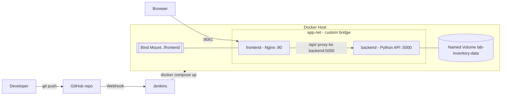

# Inventaris Barang Laboratorium (Ujian Chunin - Cloud Computing)

**Studi kasus:** #4 Inventaris Barang Laboratorium (Lab Inventory Catalog)

## Anggota Kelompok
| Nama | NIM |
|------|-----|
| (isi) | (isi) |
| (isi) | (isi) |
| (isi) | (isi) |

## Arsitektur



| Komponen | Detail |
|----------|--------|
| Backend | Python `http.server`, `GET/POST/DELETE /inventory`, data di `/var/lib/backend_data/inventory.json` |
| Volume | Named Volume `lab-inventory-data` |
| Frontend | HTML + Vanilla JS, Nginx, Bind Mount `./frontend` |
| Network | `app-net` (bridge), antar-service via DNS `backend` |
| CI/CD | Jenkinsfile 5 stage + GitHub Webhook |

## API
| Method | Endpoint | Keterangan |
|--------|----------|------------|
| GET | `/inventory` | Daftar alat |
| POST | `/inventory` | Body JSON: `name`, `category`, `quantity`, `status` (Tersedia/Dipinjam/Rusak) |
| DELETE | `/inventory?index=X` | Hapus alat berdasarkan index |
| GET | `/health` | Health check |

Error: `400` (input tidak valid), `404` (endpoint/index tidak ada).

## Menjalankan Lokal
```powershell
docker compose up -d --build
```
- UI: http://localhost:8081
- API langsung: http://localhost:5000/inventory

## Demo Data Immunity
```powershell
.\demo.ps1
```

## Setup Jenkins
1. Buat GitHub PAT (scope `repo`, `admin:repo_hook`), simpan di Jenkins Credentials (Username with password).
2. Buat Pipeline job -> *Pipeline script from SCM* -> Git -> URL repo, branch `*/main`, Script Path `Jenkinsfile`.
3. Centang *GitHub hook trigger for GITScm polling*.
4. Ekspos Jenkins (mis. ngrok), lalu di GitHub: Settings -> Webhooks -> Payload URL `https://<ngrok>/github-webhook/`, content type `application/json`, event *push*.
5. `git push` ke `main` -> pipeline jalan otomatis.
